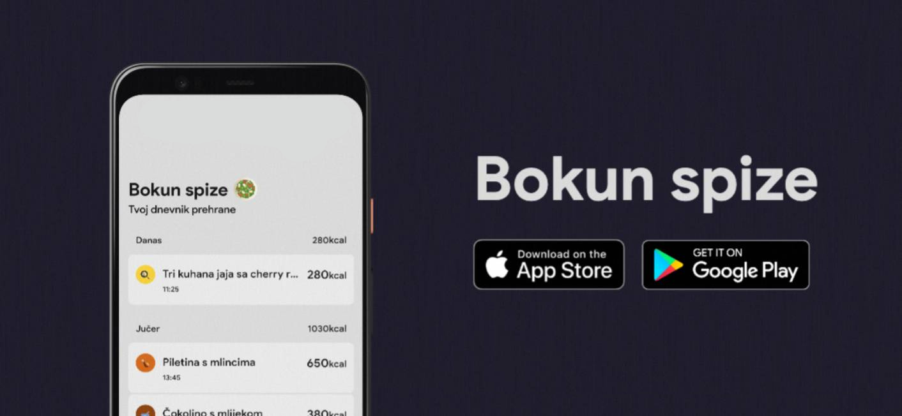
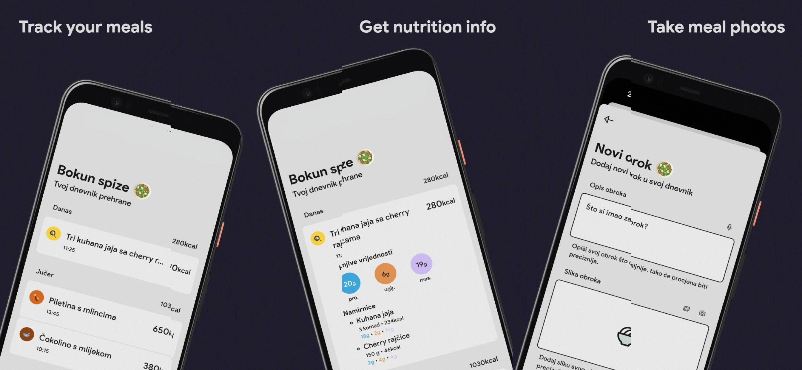

- [ ] Update deprecated `material.dart`
- [ ] Replace all `TextStyle()`
- [ ] Animations
- [ ] Think about `constants.dart`
- [ ] App name -> Bokun / Bite
- [ ] Email that user gets when logged in using Google and probably Apple
- [ ] Go through every hardcoded text and check if it makes sense
- [ ] Add Meal screens - show dismissible widgets with info
- [ ] `AccountScreen`
    - [ ] Notifications
        - [ ] Notifications reminding to weight
        - [ ] Notifications analyzing previous day (meals, weight, walks)
        - [ ] Announcements
        - [ ] Provisional notifications
- [ ] Firebase App Check
    - [ ] Add the Play App Signing SHA-256
    - [ ] Change PLAY_RECOGNIZED to Required
    - [ ] Optionally change LICENSED to Required
    - [ ] Minimum acceptable device integrity -> Don't explicitly check
    - [ ] The legacy sideloaded APK will then stop working
- [ ] Analytics
- [ ] Crashlytics
- [ ] Perhaps anonymous sign-in
- [ ] App purchases - Research & initial implementation
- [ ] Identifier should maybe be `com.josipkilic.bokunspize`

# Bokun spize 🥗

🥗 **Bokun spize** is a simple fitness app made in **Flutter**. 👨‍💻

It gives you the ability to add your meals, weights and walks into a list. 🍂\
Everything is displayed using a minimalistic design which gives you all info at a glance. 📈\
You can see data by day and keep everything organized. 🗂️

### Bokun spize can be downloaded from [HERE](https://play.google.com/store/apps/details?id=com.josipkilic.bokun_spize).
&nbsp;

**Meals** 🥙

Shows a list of your meals.\
It's grouped by day, so you can see everything properly structured.

**Weights** 🧾

Shows a list of your weights.\
You can add your new weight when necessary.\

**Walks** 🐾

Shows a list of your walks.\
Gets values from your phone data.\

**Account** 📈

Set your calorie goals here.\
Add data about yourself and the app will calculate your daily calorie needs.
